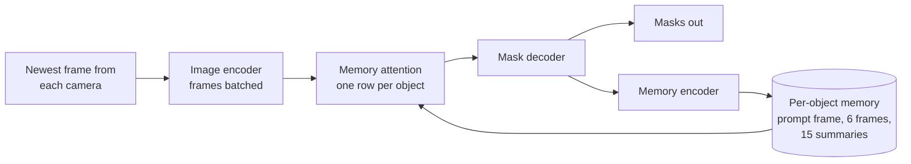

<div align="center">

# tamserve

**Live, multi-camera tracking with SAM 2, on one GPU or many.**

SAM 2 and its smaller sibling EdgeTAM can track anything you point at, but their code was written for one recorded video at a time.<br>
tamserve is the serving engine they are missing: one copy of the model tracks every object on every camera, for as long as the cameras run.<br>
Point at what to track, or name it ("dog", "the red mug") and tamserve finds it.


[](https://colab.research.google.com/github/aryamandarda/tamserve/blob/main/notebooks/quickstart.ipynb)

[Why tamserve](#why-tamserve) · [New to video tracking?](#new-to-video-tracking) · [Using it](#using-it) · [Tracking by name](#following-what-you-name) · [How it works](#how-it-works) · [Results](#results) · [Limits](#limits)

<a href="https://github.com/aryamandarda/tamserve/blob/main/docs/media/tamserve-demo.mp4"></a>

<sub>Six live cameras on one GPU, every one at 30 frames/s. <a href="https://github.com/aryamandarda/tamserve/blob/main/docs/media/tamserve-demo.mp4">Watch the 32-second demo</a>, or read <a href="https://github.com/aryamandarda/tamserve/blob/main/docs/demo.md">how it was recorded</a>.</sub>

</div>

## Why tamserve

The models are excellent. The code that comes with them was made for editing one recorded video, and the usual way to put it on several cameras is to run a separate copy of the model for each one. Memory piles up with every copy and with every minute of video.

tamserve does what LLM servers such as vLLM do for chat: every camera shares one copy of the model, and whatever needs the GPU at a given moment goes through it together. That turns out to be faster as well as lighter, and because the model itself is not touched, the results are the same.

| | the model's own code | tamserve |
|---|---|---|
| Several cameras | one copy of the model per camera | one copy for all of them |
| GPU memory, 8 cameras | 8.6 GB | 2.2 GB |
| Speed, 1 camera | 177 frames/s | 219 frames/s |
| Speed, 8 cameras | 280 frames/s | 323 frames/s |
| 64 cameras | would need about 70 GB of GPU memory | 321 frames/s in 5.7 GB |
| GPU memory for an 800-frame video | 9.8 GB | 0.28 GB, however long it runs |
| Starting to track something new mid-stream | not possible | on any frame |
| Finding what to track | you point at each object | you point, or you name it and a `Tracker` finds and follows every match by itself |
| Several GPUs | you split the cameras between them by hand | a `Router` places the cameras and gathers every result |
| Accuracy on DAVIS 2017 | 0.8686 | 0.8685 |

These are for EdgeTAM on one RTX 4090, against EdgeTAM's own code at its fastest: compiled, one copy per camera, all sharing the GPU. Speeds are totals across the cameras, with one object each. With the larger SAM 2.1 models, tamserve runs at the same speed as Meta's current SAM 2 code and uses about a third of the GPU memory. [Results](https://github.com/aryamandarda/tamserve/blob/main/docs/results.md) has the full tables.

## New to video tracking?

Say you have video, and you need to know where one particular thing is in every frame: this person, that forklift, the dog. That is tracking. SAM 2 and its smaller relatives, EdgeTAM and SAM 2.1, are models from Meta that do it very well. You point at the thing once, on a single frame, and the model draws its exact outline on every frame after that.

tamserve sits between one of those models and your program. Your program hands it the latest frame from each camera and gets back the outline of every tracked object in each one. You can start tracking something new, or stop, at any moment, and cameras can come and go.

It is meant for anyone who has to answer "where exactly is this thing, right now, in each of my video feeds": sports and broadcast graphics, warehouse and retail analytics, robotics, wildlife and lab monitoring, annotation tools.

There are two ways to say what to track. You can point: a person clicking on the picture, or a detector, says where the thing is, and tamserve takes over from there. Or you can name it: a [`Tracker`](#following-what-you-name) takes a word or a phrase, finds everything that matches on every camera, and follows it.

Four words come up a lot below:

| word | what it means here |
|---|---|
| frame | one image from a video |
| mask | the answer for one object in one frame: a grid of True and False the size of the frame, True on every pixel that belongs to the object |
| prompt | how you say what to track: a box around it, a click on it, a rough mask of it, or, with a `Tracker`, a word or a phrase |
| stock | the model's own code: the tracker in Meta's EdgeTAM repository, used exactly as it comes |

## Using it

### Install

```bash
pip install tamserve
```

You need Python 3.10 or newer and an NVIDIA GPU. It does run on a CPU, which is handy for trying it out but much too slow for live video.

The first time you load a model, tamserve downloads it into `~/.cache/tamserve`, so that run needs an internet connection. EdgeTAM is 54 MB. The download is pinned to one version and verified before any of it is loaded.

### A live loop

tamserve does not open cameras, and it does not run a loop of its own. Your program reads frames however it likes and calls `engine.step()` once per round, with the newest frame from each camera exactly as the decoder gives it. This example uses OpenCV to read two network cameras:

```python
import threading

import cv2  # pip install opencv-python; any source of frames will do
from tamserve import Box, Engine, build_video_predictor


class Camera:
    """Reads one stream on a thread of its own and keeps its newest frame."""

    def __init__(self, url):
        self.stream, self.newest, self.arrived = cv2.VideoCapture(url), None, threading.Event()
        threading.Thread(target=self.read, daemon=True).start()

    def read(self):
        while True:
            ok, picture = self.stream.read()
            if not ok:
                break  # the stream has ended
            self.newest = cv2.cvtColor(picture, cv2.COLOR_BGR2RGB)  # OpenCV gives BGR, the engine takes RGB
            self.arrived.set()

    def take(self):
        """Waits for a frame the loop has not seen yet, and returns it."""
        self.arrived.wait()
        self.arrived.clear()
        return self.newest


engine = Engine(build_video_predictor("cuda"))  # loads EdgeTAM onto the GPU
cameras = {"door": Camera("rtsp://door-camera/stream"), "yard": Camera("rtsp://yard-camera/stream")}

# What to track and where it is in the first frame: a box as (left, top, right, bottom), in pixels.
# In a real system this comes from a detector, or from someone drawing on the picture.
start = {"door": {"courier": Box(410, 120, 560, 480)}}

while True:
    # 1. Take the newest frame from each camera.
    frames = {name: camera.take() for name, camera in cameras.items()}

    # 2. One call tracks every object in every one of those frames.
    masks = engine.step(frames, start)
    start = None  # the box was only needed once; from here on the engine tracks the courier by itself

    # 3. Use the answer. masks["door"]["courier"] is True on the courier's pixels and False everywhere else.
    for camera_name, objects in masks.items():
        for object_name, mask in objects.items():
            print(camera_name, object_name, "covers", int(mask.sum()), "pixels")
```

Each call to `step()` takes one frame per camera and returns when the masks for those frames are ready. The engine remembers what it is tracking between calls, which is why the box is passed only once. Camera names and object names are yours to choose.

The frames go in exactly as the decoder gives them. The engine uploads them and resizes them on the GPU, which takes about half a millisecond a frame where resizing on the CPU takes 16. The `Camera` class is there for speed too: with a thread per camera, the next round's frames are decoded while the GPU tracks this one. And because a camera keeps only its newest frame, a loop that falls behind skips frames and does not lag. The engine tracks from whatever frame it is given and does not need to see every one.

How fast can the loop go? On an RTX 4090 with the compiled engine, eight 720p cameras and one object each, a loop like this one tracks 273 frames a second from video to masks, which is 34 for every camera. With 1080p cameras it is 238.

### Pointing at things

To start tracking something, you give it a name and point at it in the current frame. There are three ways to point. All of them use the frame's own pixel coordinates, with x counted from the left edge and y from the top.

| prompt | what it is |
|---|---|
| `Box(left, top, right, bottom)` | A rectangle around the thing. This is the most reliable, and it is what a detector gives you. |
| `Clicks([(x, y), ...])` | One or more points on the thing, as from a mouse. A second list of 1s and 0s can mark each point as on the thing (1) or deliberately off it (0). |
| a mask | A True/False array the size of the frame, if you already have the outline from somewhere else. |

### The four things you can do

**Start tracking something.** Pass its name and where it is, together with the frame it is in. You do this once. Everything already being tracked carries on undisturbed.

```python
engine.step(frames, {"yard": {"dog": Box(300, 380, 420, 470)}})
```

**Stop tracking something.**

```python
engine.drop("door", "courier")  # just the courier
engine.drop("door")             # everything on the door camera
```

**Fix a track that has gone wrong.** Now and then an outline drifts. It slides onto the wrong person, or keeps only half of the object. Point at the object again under the same name, exactly as you did to start it. Tracking begins afresh from the new box, and the old, mistaken history is thrown away.

```python
engine.step(frames, {"door": {"courier": Box(455, 130, 600, 500)}})  # same name, new box
```

**Start something you noticed in the frame you just processed.** `step()` moves every tracked object forward by one frame. Suppose a detector looked at the frame you just passed in and found a dog. Calling `step()` again with that same frame would move everything else forward twice. `add()` starts the dog on that frame and leaves the rest alone.

```python
engine.add(frames, {"yard": {"dog": Box(300, 380, 420, 470)}})  # frames: the ones you just gave step()
```

### Following what you name

Everything above starts from someone pointing at the thing. A `Tracker` takes words instead. Give it a phrase, or several, and it finds every match on every camera, follows each one, picks up new ones as they appear and lets go of those that leave.

<div align="center">
<a href="https://github.com/aryamandarda/tamserve/blob/main/docs/media/tamserve-name-it.mp4"></a>

<sub>One live camera on one RTX 4090. The words are set while it runs, and nobody points at anything. <a href="https://github.com/aryamandarda/tamserve/blob/main/docs/media/tamserve-name-it.mp4">Watch the 17-second clip</a>, read <a href="https://github.com/aryamandarda/tamserve/blob/main/docs/demo.md#the-naming-clip">how it was recorded</a>, or <a href="https://colab.research.google.com/github/aryamandarda/tamserve/blob/main/notebooks/tracking_by_name.ipynb">try it in Colab</a>.</sub>
</div>

```python
from tamserve import Engine, Tracker, build_video_predictor

engine = Engine(build_video_predictor("cuda", "sam2.1-large"), compile=True)
tracker = Tracker(engine, {"door": ["person", "package"], "yard": "dog"})  # loads SAM 3, the model that finds things

while True:
    frames = {name: camera.take() for name, camera in cameras.items()}  # as in the live loop above
    masks = tracker.step(frames)
    # masks["door"] is {1: mask, 2: mask, 3: mask}: one mask for everything found on the door camera
    # tracker.names("door") is {1: "person", 2: "person", 3: "package"}: what each of them is
```

For the same phrase on every camera, `Tracker(engine, "dog")` is enough. Each thing gets a number, counted from 1 on each camera, and keeps it for as long as it is followed.

It works by pairing two models. SAM 3 is Meta's model that outlines whatever you name. It is accurate and slow: one look at one frame takes about 65 ms on an RTX 4090. The model inside the engine cannot find anything by itself, but it follows what it is given far more cheaply, a few ms a frame with EdgeTAM and a few tens with SAM 2.1 large. So SAM 3 looks at each camera once every three frames, the engine follows what it found in between, and the looks are spread out so that they never all land in the same round.

SAM 3 can also follow things through a video by itself. Here are the two side by side on one RTX 4090, on 117 videos from Meta's own benchmark for SAM 3, each paired with phrases such as "the white scarf" (224 pairs, none of them used to choose any setting). The security cameras are a second set of videos:

| | SAM 3's own tracker | `Tracker` |
|---|---|---|
| Accuracy (HOTA) | 59.4 | 56.3, which is 95% of it |
| GPU time per frame | 101 ms | **41 ms** |
| Following with EdgeTAM, the smaller model | | 54.6 at **26 ms** |
| Frames per second, when there is something to follow | 8, one video at a time | 15 on one camera, or 1 on each of 16; twice that with EdgeTAM |
| Several things asked of one camera | a full pass for each | one look for all: 30 ms each at two a camera, 17 ms at eight |
| Security cameras that do not move, five things asked of each | 116 ms for each | 13 ms for each, with `still=True` |
| GPU memory | grows with the video | 6.8 GB for 16 cameras, the same after 19 minutes |

HOTA is the usual score for tracking, from 0 to 100. It combines how well things are found with how well each one keeps the same number. So `Tracker` gives up a few points of accuracy and costs two fifths as much, or a quarter with EdgeTAM. It also does three things SAM 3's tracker cannot: it runs many cameras at once, it asks one camera for several things at little extra cost, and its memory does not grow with the video. [Results](https://github.com/aryamandarda/tamserve/blob/main/docs/results.md#anything-you-name) has the full tables.

| if you want | do this |
|---|---|
| a lower cost, for a little accuracy | follow with EdgeTAM, the engine's default model: `Engine(build_video_predictor("cuda"), compile=True)` |
| cameras that do not move to cost less | `Tracker(engine, prompts, still=True)`. A camera looks again only when its picture has changed, and is not followed while nothing moves. On security-camera video that cut the cost by two fifths and moved the answers by about a point. |
| new things found sooner | `Tracker(engine, prompts, look_every=1)`. It costs about twice as much and does not raise accuracy. |
| a quiet camera to cost less | `Tracker(engine, prompts, look_every={"storeroom": 15})`. That camera is looked at every 15th frame, so new things on it are found later, and the cameras not named keep 3. The dict can be changed while running. |
| something out of sight to keep its number for longer | `Tracker(engine, prompts, hold=900)`: the number of frames a thing no look has seen is still followed. The default is 300. Everything seen in that time is still being followed, so on a busy camera a shorter hold costs less. |

`Tracker` and `PeopleTracker` are add-ons. They need Meta's SAM 3, which does not come with tamserve unless you ask for it:

```bash
pip install "tamserve[sam3]"
hf auth login  # once: SAM 3's weights are gated
```

Before the weights will download, accept Meta's licence on the [facebook/sam3](https://huggingface.co/facebook/sam3) page on Hugging Face. They are 3.5 GB and are fetched the first time a tracker starts. SAM 3 has its own licence, which is not Apache-2.0, so read it before you build on it.

### Following people

People are what cameras are most often asked about, so they have a tracker of their own. A `PeopleTracker` works as a `Tracker` does, with rules tuned on people: it looks five times less often, and it is both more accurate and far cheaper than SAM 3's own tracker.

```python
from tamserve import Engine, PeopleTracker, build_video_predictor

engine = Engine(build_video_predictor("cuda"), compile=True)
people = PeopleTracker(engine)  # loads SAM 3, the model that finds the people

while True:
    frames = {name: camera.take() for name, camera in cameras.items()}  # as in the live loop above
    masks = people.step(frames)
    # masks["door"] is {1: mask, 2: mask}: one mask for each person in view on the door camera
```

Each person gets a number, counted from 1 on each camera, and keeps it for as long as they are followed. Someone hidden for a moment, behind a door or another person, has the same number when they reappear.

It pairs the same two models. People move slowly against the size of a picture and SAM 3 is sure of them, so one look every 15 frames is enough, and EdgeTAM, the smallest model, follows them for about 4 ms a frame.

SAM 3 can also track people through a video by itself. Here are the two side by side, on one RTX 4090 and the same videos:

| | SAM 3's own tracker | `PeopleTracker` |
|---|---|---|
| People at home, 116 videos: accuracy (HOTA) | 87.8 | **89.6** |
| GPU time per frame | 126 ms | **8.9 ms** |
| Cameras at once | one video at a time | 16 at 5 frames/s each, or 64 at 1.4 |
| GPU memory over a 3,000-frame video | out of memory at frame 423 | 3.5 GB from start to end |
| Crowded streets: accuracy (HOTA) | 77.7 | **78.3** with a look at every frame, 72.6 with the default |
| GPU time per frame | 521 ms | 183 ms, or 44 ms with the default |

[Results](https://github.com/aryamandarda/tamserve/blob/main/docs/results.md#people) has the full tables.

| if you want | do this |
|---|---|
| people in a crowd found sooner and swapped less | `PeopleTracker(engine, look_every=1)`. SAM 3 then looks at every frame, which costs more. The default, 15, suits rooms with a few people. |
| one crowded camera beside quiet ones | `PeopleTracker(engine, look_every={"plaza": 1})`. Only that camera is looked at on every frame, and the cameras not named keep 15. The dict can be changed while running. |
| someone out of sight to keep their number for longer | `PeopleTracker(engine, hold=90)`: the number of frames a person no look has seen is still followed. The default is 30. |
| your own detector in place of SAM 3 | `PeopleTracker(engine, finder=my_detector)`: anything that takes a list of frames and returns a list of masks for each |

### Options

| if you want | do this |
|---|---|
| a different model | `build_video_predictor("cuda", "sam2.1-tiny")`. The same works with `-small`, `-base-plus` and `-large`. |
| masks left on the GPU instead of copied to the CPU | `Engine(predictor, gpu_masks=True)` |
| masks identical to stock's, bit for bit | `Engine(predictor, exact=True)`, and pass each frame through `prepare(frame)` first: it resizes on the CPU exactly as stock does, where the engine's own resize on the GPU can be off by 1 in a pixel's value |

### Compiling for speed

`Engine(predictor, compile=True)` compiles the model for your GPU. Every speed figure on this page uses it, and the price is a slow first start.

| `compile=` | first start on a machine | later starts | speed |
|---|---|---|---|
| `True` | about 20 minutes | about 95 seconds | the fastest |
| `"default"` | under 3 minutes | about a minute | 3 to 8% slower from 4 cameras up, 20% slower at two, half the speed at one |
| left off | 2 seconds | 2 seconds | 55 frames/s at one camera, about 200 from four up |

Later starts are quick because PyTorch keeps the compiled code on disk. By default it keeps it in `/tmp`, so point `TORCHINDUCTOR_CACHE_DIR` at a folder that survives a reboot. Compiling has only been tested on Linux.

### Several GPUs

One engine drives one GPU. For several, on one machine or many, use a `Router`. It runs a worker on each GPU, puts each camera on the one with the most room, and gives you every camera's results in one place. Each worker opens and decodes its own cameras, so video never travels between them.

```python
from tamserve import Box, Router


def main():
    router = Router(compile=True)  # a worker on every GPU this machine has
    router.add_camera("dock-1", "rtsp://10.1.0.21/stream")
    router.add_camera("dock-2", "rtsp://10.1.0.22/stream")
    router.start("dock-1", "forklift", Box(410, 120, 560, 480))

    for update in router.results():  # every camera, whichever GPU tracked it
        for name, mask in update.masks.items():
            print(update.camera, update.frame, name, mask.box, mask.area)


if __name__ == "__main__":  # each worker is a new Python process, and it imports this file as it starts
    main()
```

The router reads the cameras itself, so you give it each camera's address instead of handing it frames. Opening streams by address needs OpenCV (`pip install opencv-python-headless`). `start()`, `stop()` and `remove_camera()` work as on an engine.

On two RTX 4090s, with one object per camera, a router tracked 476 frames a second from 32 cameras of 720p video, against 241 on one GPU. A router keeps going when a camera drops or a worker stops, and its workers can be on other machines: [Several GPUs](https://github.com/aryamandarda/tamserve/blob/main/docs/several-gpus.md) covers both.

## How it works

For every frame, a SAM 2-style tracker encodes the image, looks the object up in its memory of recent frames, draws the mask, and writes the frame into that memory. tamserve runs those same four modules, once per step, over every object on every camera.



Five things make that fast. None of them changes what the model computes; at most they change floating-point rounding.

1. **Every object is a row in one batch.** This is continuous batching, as LLM servers do it: every object that has a new frame shares one pass through the model.
2. **An object keeps only the memory the model reads.** That is the frame it was prompted on, its last 6 frames and a short summary of its last 15, however long the camera has run.
3. **The CPU never waits inside a step.** A GPU works through a queue the CPU fills, and some operations make the CPU stop until the queue is empty. Twelve such waits per step became one.
4. **One position encoding, not one per frame.** That made a step 4 to 7% faster and nearly halved GPU memory at 64 cameras.
5. **Compiled code for a batch that keeps changing size.** The engine cuts every batch into power-of-two pieces and compiles all five sizes up front, so nothing compiles mid-stream.

The full account is in [docs/how-it-works.md](https://github.com/aryamandarda/tamserve/blob/main/docs/how-it-works.md). What each change bought, and what was tried and dropped, is in [docs/results.md](https://github.com/aryamandarda/tamserve/blob/main/docs/results.md#what-each-change-bought).

## Results

The table under [Why tamserve](#why-tamserve) is the short version, and the sections on [naming things](#following-what-you-name) and [people](#following-people) have their own. Every measurement, with the machine it ran on and the command that reproduces it, is in [docs/results.md](https://github.com/aryamandarda/tamserve/blob/main/docs/results.md): speed from 1 to 64 cameras, accuracy for all five models, memory, SAM 2.1 against Meta's current code, live video, two GPUs, and both trackers against SAM 3's own.

## Limits

What tamserve does not do:

- **Track backwards.** It only moves forward in time, which is all a live camera needs. Stock can also run backwards from a prompt in a recorded clip.
- **Adjust a mask without restarting it.** Fixing a track means pointing at the object again, and tracking starts over from there. Stock can also nudge a mask with an extra click, or take prompts on several frames.
- **Find things by itself, without SAM 3.** The engine follows what it is pointed at, and when an object leaves the view its mask comes back empty. Finding things by name is the job of `Tracker` and `PeopleTracker`, and both need SAM 3 installed.
- **Match SAM 3's accuracy on everything.** On people, `PeopleTracker` scores above SAM 3's own tracker. On other things `Tracker` reaches 95% of its score.
- **Make a look cheaper by adding cameras.** The following is batched across cameras and the looks are not. So with `Tracker` an RTX 4090 tracks about 30 frames a second in total with EdgeTAM and 16 with SAM 2.1 large, however many cameras share them: six cameras at 5 frames a second each with EdgeTAM, or three with SAM 2.1 large. `look_every` and `still` are the ways to stretch that.
- **Know a thing across cameras, or after a long absence.** Both trackers number things on each camera separately, and something gone for longer than `hold` frames comes back under a new number. They run on one engine, so one GPU: they do not work through a `Router` yet.
- **Follow everyone in a packed crowd.** With 90 people in every frame, `PeopleTracker` follows 72% of those in plain view. `PeopleTracker(engine, start=0.5)` raises that to 84%, and swaps numbers nearly twice as often.

What to expect in practice:

- **More objects cost more.** The speeds on this page are for one object per camera, and each extra object adds about 2.4 ms to a round.
- **The first compiled start takes about 20 minutes.** After that it is about 95 seconds, as long as PyTorch's cache of compiled code is still there. `compile="default"` is ready in under 3 minutes.
- **Other GPUs will give other numbers.** tamserve runs on any NVIDIA GPU that PyTorch supports and gives the same masks there, but every speed on this page comes from one RTX 4090. Older GPUs without hardware support for bf16, the number format the models run in, are far slower than their age suggests: on the T4 that Colab gives for free, one look by SAM 3 takes 3 seconds.

## Read more

| | what it covers |
|---|---|
| [How it works](https://github.com/aryamandarda/tamserve/blob/main/docs/how-it-works.md) | the model, continuous batching, each speed change and why it is exact, where the code is |
| [Results](https://github.com/aryamandarda/tamserve/blob/main/docs/results.md) | every measurement with its command, start-up times, the per-stage profile, what was tried and dropped |
| [Several GPUs](https://github.com/aryamandarda/tamserve/blob/main/docs/several-gpus.md) | what a router sends back, what happens when a camera or a worker fails, workers on other machines |
| [The demo video](https://github.com/aryamandarda/tamserve/blob/main/docs/demo.md) | what each scene shows, how it was recorded, footage sources |

## Credits and licence

Created by [**Aryaman Darda**](https://github.com/aryamandarda).

tamserve is Apache-2.0. It runs [EdgeTAM](https://github.com/facebookresearch/EdgeTAM) and [SAM 2.1](https://github.com/facebookresearch/sam2) by Meta, both Apache-2.0, which it downloads and does not redistribute. Accuracy is measured on [DAVIS 2017](https://davischallenge.org/), which is for research use; check its licence before using it for anything else. `Tracker` and `PeopleTracker` call Meta's [SAM 3](https://github.com/facebookresearch/sam3), which has its own licence, is not part of tamserve, and is only installed and downloaded when you ask for it. They are scored on [SA-Co/VEval](https://huggingface.co/datasets/facebook/SACo-VEval), [BURST](https://github.com/Ali2500/BURST-benchmark), [MOTS20 and MOT20](https://motchallenge.net/) and [MEVA](https://mevadata.org) (CC BY 4.0), each under its own terms. The demo's footage is from [Pexels](https://www.pexels.com), under the Pexels licence; sources are listed in [docs/demo.md](https://github.com/aryamandarda/tamserve/blob/main/docs/demo.md).
