# Echoes in Light VJ

**A real-time, audio-reactive VJ engine for TouchDesigner.**
It listens to the room, finds the beat, works out the vibe of the track, and performs on its own.

[Instagram @echoes_in_light11](https://instagram.com/echoes_in_light11) · built with TouchDesigner · MIT licensed

---

## What it does

Point a mic at the speakers and it plays the visuals for you:

- **Hears the drums separately.** Kick, snare and hi-hat each get their own onset detector with adaptive thresholds, so quiet and loud rooms both work.
- **Locks to the tempo.** A tempo histogram plus a phase-locked beat grid keeps scene changes and strobes on the bar, even when a kick is missed. Tap tempo (`T`) for tracks that confuse it.
- **Reads the song structure.** Detects breakdowns, build-ups and drops: trails stretch in the breakdown, a 16th-note strobe ramps up through the build, and the drop hits with a white flash and an instant scene cut.
- **Picks a vibe by itself.** Every few beats it classifies the track from kick rate, hi-hat rate and bass weight:
  | Mood | Sounds like | Scenes |
  |---|---|---|
  | **Club** | steady four-on-the-floor | neon tunnel, acid bloom, lava kaleido, strobe grid |
  | **Chill** | sparse kicks, low energy | ice vortex, deep space, purple rain |
  | **Syrup** | heavy 808s, trap hats | syrup drip, double cup, purple rain, codeine dream |
- **Knows when a song changes.** A silence gap or a big shift in the groove resets the tempo and moves to a new look.
- **Records reels.** One key records 720x1280 vertical (or widescreen) clips at 60 fps.
- **Ready to project.** Full-screen output on any display with a corner-pin for mapping onto walls and objects.

## Scenes

Ten scenes, four wireframe shapes, six palettes. Every scene is one row in [`data/scenes.tsv`](data/scenes.tsv): add a row to add a scene.

## Quick start

1. Install [TouchDesigner](https://derivative.ca/download) (the free Non-Commercial licence works).
2. Open a new project and drag **`echoes_in_light_vj.tox`** into the network.
3. Play music near your laptop mic (allow microphone access when macOS asks).
4. Select `vj_rig/projector_window` and click **Open** to go full screen on the projector.

## Controls

Keys work while the TouchDesigner window is focused.

| Key | Action |
|---|---|
| `T` | Tap tempo (4+ taps locks the beat grid) |
| `Y` | Back to automatic tempo |
| `1`-`6` / `0` | Hold a scene / back to automatic scenes |
| `K` | Kaleidoscope on/off |
| `B` | Blackout |
| `R` | Start/stop recording to `~/Movies/VJ_clips` |
| `V` | Vertical reel / widescreen recording |
| `Esc` | Close the projector window |

More settings live in the `controls` CHOP: `mood_lock` (-1 auto, 0 club, 1 chill, 2 syrup), `scene_lock`, `master`, `speed`.

## How it works

```mermaid
flowchart LR
    MIC[Mic in] --> BANDS[Bass / mid / high filters]
    BANDS --> ENGINE[Beat engine<br/>onsets · tempo grid · sections · mood]
    ENGINE --> SCENES[Scene picker]
    SCENES --> SRC[Noise + palette + 3D wireframe]
    SRC --> LOOP[Feedback loop<br/>zoom · spin · melt · hue]
    LOOP --> KAL[Kaleidoscope]
    KAL --> POST[Post shader<br/>glitch · RGB split · sharpen · strobe · flash]
    POST --> AE[Auto exposure]
    AE --> OUT[Projector + recorder]
```

| Path | What's inside |
|---|---|
| `echoes_in_light_vj.tox` | The whole rig as one drop-in component |
| `src/beat_engine.py` | Onset detection, tempo histogram, phase-locked grid, section and mood detection |
| `src/density_control.py` | Keeps every scene at the same visual density |
| `src/keyboard_controls.py` | Performance keys and tap tempo |
| `src/recorder_namer.py` | Timestamped clip names |
| `shaders/fx_post.frag` | Glitch slices, chromatic split, unsharp mask, strobe, drop flash, vignette |
| `shaders/melt_warp.frag` | The syrup drip / sway inside the feedback loop |
| `data/` | Scene table and colour palettes |

The `.py` / `.frag` files are copies of the DATs inside the `.tox`, kept here so the code is readable on GitHub.

## Known limits

- The free TouchDesigner licence caps output at 1280x720 and blocks H.264 recording, so clips are saved as MPEG-4. Convert with ffmpeg for upload:
  `ffmpeg -i clip.mp4 -c:v libx264 -crf 20 -pix_fmt yuv420p out.mp4`
- Listening through a mic adds roughly 40-70 ms of delay. A loopback device such as BlackHole is tighter.
- Syncopated trap 808s can confuse the automatic tempo grid. Use tap tempo.

## License

MIT © Yuvraj Pegu. See [LICENSE](LICENSE).
